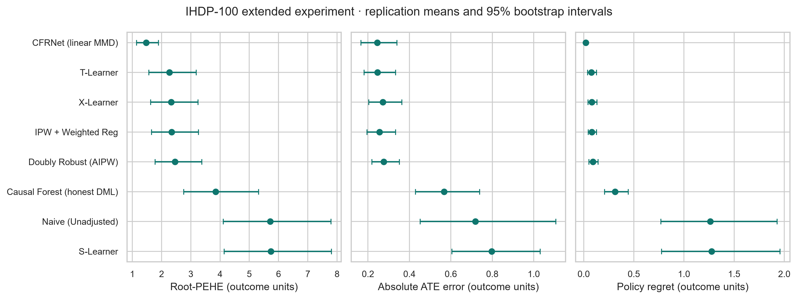

# Independent scientific verification

## Answer to Sindhu

PR #14 at 53c9ca7 benchmarked six estimators. The full reachable branch history, executable model declarations, registry, dependencies and 600 exported rows contained no implementation or results for either Causal Forest or CFRNet. CFRNet identified the data lineage. The audit branch adds both as optional models in a separate 800-fit experiment. The default registry and original 600-row release still contain six.

## Data and estimands

The author-hosted CFRNet-lineage IHDP-100 NPZ archives have 25 covariates, 672 training and 75 test rows per draw. SHA-256 train `750697c71b4f8d7a3aafff771b56a4ac4cd83ec649bf69afb04f8a5aee41a240`, test `a70a8acbcc4e8deb677cc9bf9e9dabeb17caaa37cdbb1d7ba06be7ffb929c41c`. Both match the recorded local baseline. Publisher signatures, patient identifiers and redistribution rights remain unverified. [Data source](https://github.com/clinicalml/cfrnet)

All 200 split-replication checks passed, including alignment, binary treatment, x14 encoding, zero exact cross-split X/T matches and original-array immutability. Sorting the pooled 747 X/T rows produced identical multisets for every one of the 100 replications. This directly rules out interpreting the replications as 100 distinct patient cohorts. Repeated simulations can support conditional Monte Carlo comparisons if their draws are exchangeable; independence of the outcome generator was not established.

The training interface gets X, t and noisy factual yf. Both archives' original splits are preserved. Test mu0 and mu1 define the reference conditional contrast. The independent verifier bypassed the package data loader, evaluation and aggregation routines, refitted from source arrays, and compared 12 fields per model and replication. RMSE uses the individual differences; the absolute ATE error uses the difference of their means. The training ATE has a different target for IPW and AIPW. CSV tolerances are 0.000050001 for legacy four-decimal fields and 0.0000005001 for CI exports. Runtime is observed, not expected to be deterministic.

## Model review and configuration

| Model | Implementation and checks |
|---|---|
| Naive | Observed treated mean minus control mean, constant across test units. |
| S-Learner | A single ridge model predicts at T=0 and T=1. The default additive specification yields constant effects. |
| T-Learner | Two independently fitted RidgeCV outcome regressions. Predictions subtract control from treated. |
| X-Learner | Opposite-arm imputation followed by two effect regressions; predicted propensity weights control-imputed effects by e and treated-imputed effects by 1−e. [Künzel et al.](https://arxiv.org/abs/1706.03461) |
| IPW + weighted regression | Logistic propensities clipped to [0.01, 0.99], normalized Hájek training ATE by default. Weighted arm regressions supply held-out contrasts. Unsupported weights trigger an explicit fallback warning; an internal weighted fit error propagates. |
| AIPW | Stratified 5-fold cross-fitting, seed 42. The pseudo-outcome is m1−m0 + T(Y−m1)/e − (1−T)(Y−m0)/(1−e). Its average estimates the training ATE, and a separate ridge regression predicts held-out effects. Small training arms trigger the documented in-sample fallback. [Kennedy](https://arxiv.org/abs/2004.14497) |
| Causal Forest | EconML 0.17.0 CausalForestDML with 128 honest trees, heterogeneity splitting, minimum leaf 5, 45% subsampling, three shuffled stratified nuisance folds, RidgeCV and logistic treatment propensity, seed 42 and one worker. Forest estimates are conditional contrasts. No invented outcome levels are exposed. [EconML](https://www.pywhy.org/EconML/_autosummary/econml.dml.CausalForestDML.html) |
| CFRNet | PyTorch CPU implementation of CFR with squared linear-kernel MMD. Two 32-wide shared layers, ELU and unit-norm representation, separate 32-wide ELU outcome heads. Loss is half each arm's factual standardized MSE plus 1.0 times the squared distance between arm-specific mean representations. Full-batch Adam, learning rate 0.005, L2 weight decay 0.0001, 100 epochs, seed 42. X and yf scalers fit exclusively on training rows. The test suite checks the MMD value and gradient and verifies that removing the penalty changes fitted effects. This is a fixed CFR-MMD configuration, not a reproduction of every hyperparameter in the original TensorFlow experiments. [Shalit et al.](https://proceedings.mlr.press/v70/shalit17a.html) |

All comparisons used the same archive slices, orientation, metric code and held-out units. Default hyperparameters were fixed before the extended full run. No oracle-driven early stopping, tuning or restart selection. Each estimator fits its own preprocessing where needed. Equal splits do not imply equal model complexity or a common tuning budget. Runtime includes model construction/clone within the timer, training and predictions, including any first-fit lazy imports. Archive reads, scoring, summary construction and server rendering are excluded. Deterministic CPU execution used one numeric thread. The first forest fit incurred substantial library initialization overhead.

## Separate eight-model experiment

| Estimator | Fits | Mean Root-PEHE [95% CI] | Median Root-PEHE [95% CI] | Mean absolute ATE error [95% CI] | Mean regret [95% CI] | Mean / median seconds |
|---|---:|---:|---:|---:|---:|---:|
| CFRNet (linear MMD) | 100 | 1.472 [1.147, 1.894] | 0.930 [0.880, 0.990] | 0.245 [0.166, 0.340] | 0.0204 [0.0160, 0.0258] | 0.4230 / 0.3286 |
| T-Learner | 100 | 2.265 [1.568, 3.183] | 0.915 [0.748, 1.053] | 0.247 [0.182, 0.333] | 0.0771 [0.0398, 0.1284] | 0.0055 / 0.0043 |
| X-Learner | 100 | 2.327 [1.630, 3.248] | 0.985 [0.849, 1.118] | 0.272 [0.204, 0.364] | 0.0821 [0.0445, 0.1321] | 0.0217 / 0.0155 |
| IPW + Weighted Reg | 100 | 2.348 [1.660, 3.260] | 0.964 [0.880, 1.143] | 0.255 [0.195, 0.334] | 0.0813 [0.0451, 0.1289] | 0.0175 / 0.0125 |
| Doubly Robust (AIPW) | 100 | 2.460 [1.776, 3.375] | 1.095 [1.004, 1.277] | 0.276 [0.219, 0.352] | 0.0915 [0.0534, 0.1431] | 0.0920 / 0.0706 |
| Causal Forest (honest DML) | 100 | 3.849 [2.760, 5.319] | 1.627 [1.253, 2.146] | 0.568 [0.430, 0.739] | 0.3125 [0.2085, 0.4449] | 0.7613 / 0.3441 |
| Naive (Unadjusted) | 100 | 5.712 [4.109, 7.797] | 2.530 [2.065, 3.090] | 0.718 [0.452, 1.106] | 1.2630 [0.7710, 1.9279] | 0.0005 / 0.0004 |
| S-Learner | 100 | 5.735 [4.138, 7.807] | 2.541 [2.061, 3.191] | 0.797 [0.605, 1.031] | 1.2768 [0.7758, 1.9585] | 0.0048 / 0.0033 |

The canonical six-model rerun matched every previously committed scientific field at the exported precision before correcting the two constant-prediction correlation columns. Constant-vector correlations are now undefined, and the defined count is zero for S-Learner and Naive. Reported 42+replication seeds were metadata errors. The actual AIPW CV seed was 42 throughout. The extended run refitted the six controls and reproduced their primary metric records exactly. Raw outputs live in [original results](../results/ihdp100_unified_results.csv) and [extended results](../results/extended/ihdp100_unified_results.csv).

The original T-Learner mean Root-PEHE is 2.265180, median 0.915 to three decimals. The five largest errors were 27.1442 (rep 27), 18.9321 (8), 15.9286 (33), 13.3226 (12) and 9.4334 (80). They remain in all aggregates. The README's 0.697 mean and 0.672 median cannot be reconstructed from the accompanying CSV. The discrepancy arose in manually maintained reporting. There is no evidenced alternate run that justifies those numbers.

## Paired inference

Summary intervals are percentile bootstrap intervals, 1,000 draws with seed 42 over replication-level metrics, computed separately for the mean and median. They describe variability across the supplied simulation draws. They are not patient confidence intervals, a clinical estimand, or a demonstration of nominal coverage in new cohorts.

Positive paired differences indicate a higher competitor Root-PEHE. Each comparison has 100 complete matched draws. The paired mean-difference interval uses 500 resamples; the two-sided paired t-test targets the mean and Wilcoxon signed rank relies on symmetry for its usual location interpretation. Holm controls the family-wise error rate within each metric/test family under valid constituent p-values. Selecting a leader on these same draws makes these exploratory comparisons. Separate five- and seven-comparison families follow.

### Original six

| Competitor vs T-Learner | Mean difference [95% CI] | Median difference | T wins | t raw / Holm | Wilcoxon raw / Holm |
|---|---:|---:|---:|---:|---:|
| Doubly Robust (AIPW) | +0.1950 [+0.1578, +0.2260] | +0.1798 | 92% | 5.61e-20 / 2.8e-19 | 6.47e-16 / 1.94e-15 |
| IPW + Weighted Reg | +0.0824 [+0.0615, +0.1046] | +0.0745 | 86% | 1.13e-11 / 4.51e-11 | 1.22e-12 / 2.43e-12 |
| Naive (Unadjusted) | +3.4465 [+2.5091, +4.4547] | +1.6673 | 94% | 1.29e-09 / 2.58e-09 | 2.71e-17 / 1.21e-16 |
| S-Learner | +3.4697 [+2.5750, +4.5007] | +1.6874 | 94% | 6.5e-10 / 1.95e-09 | 2.41e-17 / 1.21e-16 |
| X-Learner | +0.0617 [+0.0428, +0.0842] | +0.0488 | 74% | 1.32e-07 / 1.32e-07 | 8.39e-10 / 8.39e-10 |

### Extended eight

| Competitor vs T-Learner | Mean difference [95% CI] | Median difference | T wins | t raw / Holm | Wilcoxon raw / Holm |
|---|---:|---:|---:|---:|---:|
| CFRNet (linear MMD) | -0.7936 [-1.3359, -0.4115] | +0.0507 | 52% | 0.000572 / 0.000572 | 0.0577 / 0.0577 |
| Causal Forest (honest DML) | +1.5839 [+1.1124, +2.1110] | +0.6689 | 89% | 2.9e-09 / 8.71e-09 | 3.57e-16 / 1.79e-15 |
| Doubly Robust (AIPW) | +0.1950 [+0.1618, +0.2337] | +0.1798 | 92% | 5.61e-20 / 3.92e-19 | 6.47e-16 / 2.59e-15 |
| IPW + Weighted Reg | +0.0824 [+0.0634, +0.1056] | +0.0745 | 86% | 1.13e-11 / 6.76e-11 | 1.22e-12 / 3.65e-12 |
| Naive (Unadjusted) | +3.4465 [+2.5510, +4.6122] | +1.6673 | 94% | 1.29e-09 / 5.15e-09 | 2.71e-17 / 1.69e-16 |
| S-Learner | +3.4697 [+2.6435, +4.4628] | +1.6874 | 94% | 6.5e-10 / 3.25e-09 | 2.41e-17 / 1.69e-16 |
| X-Learner | +0.0617 [+0.0428, +0.0875] | +0.0488 | 74% | 1.32e-07 / 2.63e-07 | 8.39e-10 / 1.68e-09 |

The two tests tell different stories for CFRNet. Relative to T-Learner, CFRNet reduced mean Root-PEHE by 0.794 while the median paired difference was +0.051. T-Learner won 52 draws. The corrected t-test p-value was 0.000572 and the corrected signed-rank p-value was 0.0577. The reduction in mean error was concentrated in harder draws. Its mean absolute ATE error differed by roughly 0.002, and unconstrained regret fell by about 0.057 outcome units. No clinically meaningful threshold is established.

## Policy simulator

Benchmark regret uses the unconstrained policy that treats positive predicted effects. The oracle averages max(mu0,mu1). Simulator regret uses a different oracle with the same maximum capacity as the evaluated rule. With higher outcomes preferred, it treats the largest strictly positive oracle effects up to floor(capacity × n). The user threshold applies to model eligibility. Ties preserve row order. Random assignments report their analytical expected value. Infeasible Treat All and empty group means have undefined constrained regret and undefined group means respectively.

The regression suite enumerates every feasible binary policy on a five-unit population with positive, negative, zero and tied effects, under 12 capacity/threshold combinations. It also covers invalid ranks, nonfinite inputs, impossible decisions and effects smaller than display precision. At replication 0 and 40% capacity the T-Learner policy value is 4.1903 and oracle value is 4.2094. These are averages of semi-synthetic potential-outcome means. Prediction agreement, refutations, clipping and model rankings cannot establish unconfoundedness or real-world benefit.
