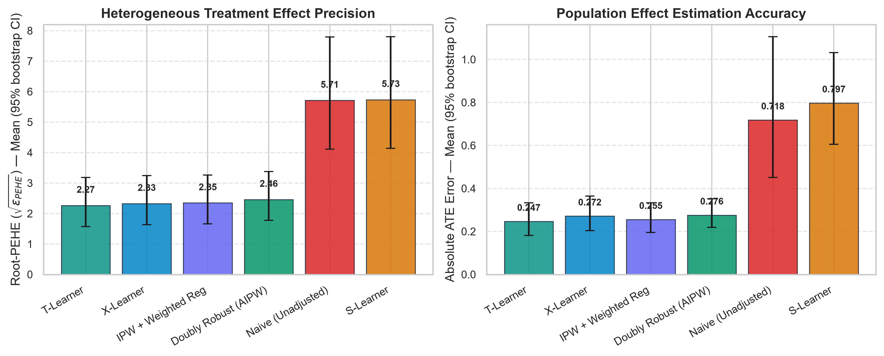
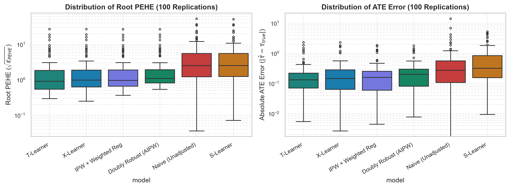
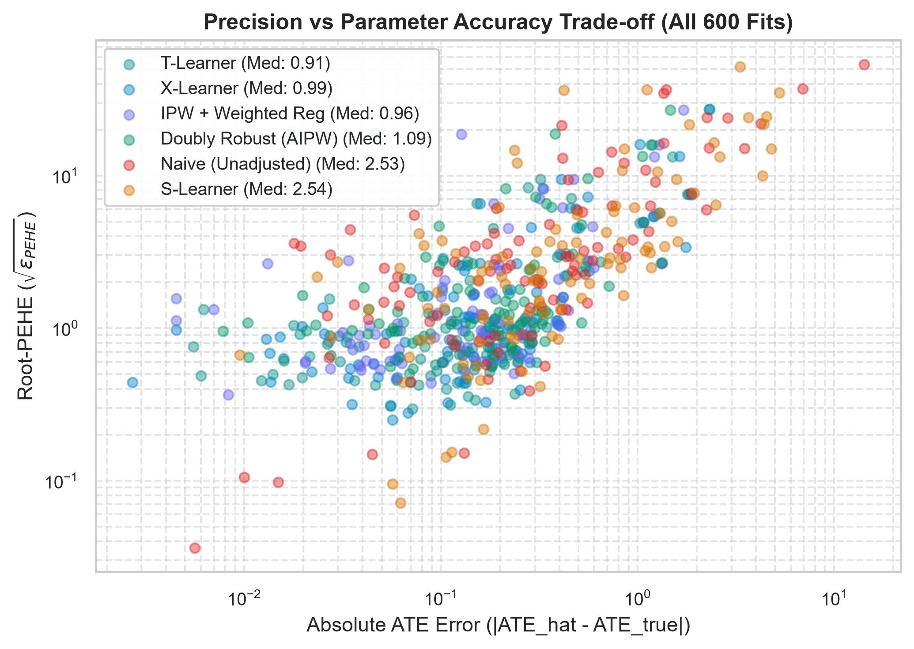
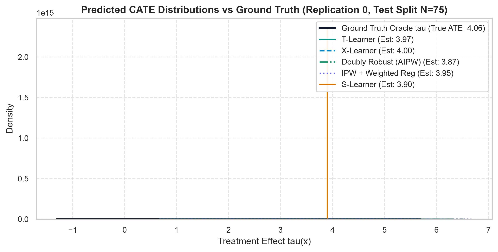
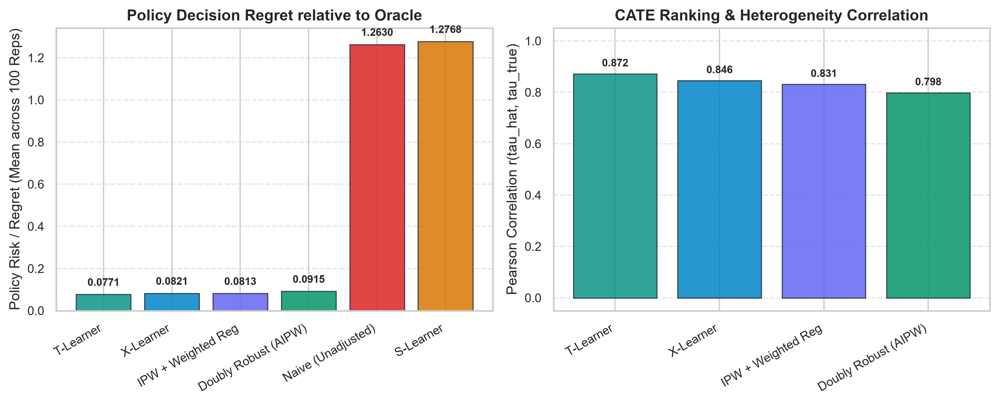

> Historical six-model report. See the [independent verification and separate eight-model experiment](ASTRA_SCIENTIFIC_VERIFICATION.md) for current results and limitations.

# CausalLens: Unified IHDP-100 Benchmark Report

**Project:** CausalLens — Causal AI & Counterfactual Decision Support  
**Competition:** DataNova Global Data-thon 2026 (Open Innovation Challenge)  
**Date:** 2026-11-08  
**Replications Evaluated:** 100 / 100 (Replications 0 to 99)  
**Model Fits Completed:** 600 / 600 (0 failures, 100% convergence)  
**Artifacts Generated:**  
- Full replication-level dataset: [`results/ihdp100_unified_results.csv`](../results/ihdp100_unified_results.csv)
- Aggregate summary metrics: [`results/ihdp100_summary.csv`](../results/ihdp100_summary.csv)
- Publication figures: [`reports/figures/`](figures/)

---

## 1. Executive Summary & Headline Results

Across all 100 benchmark replications of the Infant Health and Development Program (IHDP-100, CFRNet lineage), **600 causal model fits** were executed under strict split isolation (training on observational features $X, T, Y_f$; evaluating exclusively on held-out test splits $N=75$ against ground-truth potential outcomes $Y(0), Y(1)$ and counterfactual contrasts $\tau = \mu_1 - \mu_0$).

| Estimator | Status | Root-PEHE Mean $\pm$ SD | Root-PEHE 95% CI (Mean) | Root-PEHE Median | Root-PEHE 95% CI (Median) | ATE Error Mean $\pm$ SD | ATE Error 95% CI (Mean) | ATE Error Median | ATE Error 95% CI (Median) | Policy Regret | Pearson $r$ | Total Runtime |
|---|:---:|:---:|:---:|:---:|:---:|:---:|:---:|:---:|:---:|:---:|:---:|:---:|
| **T-Learner** | 100/100 | **2.265 $\pm$ 3.997** | [1.568, 3.183] | **0.915** | [0.748, 1.053] | **0.247 $\pm$ 0.380** | [0.182, 0.333] | **0.134** | [0.110, 0.169] | **0.0771** | **0.872** | 0.35 s |
| **X-Learner** | 100/100 | 2.327 $\pm$ 3.994 | [1.630, 3.248] | 0.985 | [0.849, 1.118] | 0.272 $\pm$ 0.394 | [0.204, 0.364] | 0.147 | [0.123, 0.187] | 0.0821 | 0.846 | 1.99 s |
| **IPW + Weighted Reg** | 100/100 | 2.348 $\pm$ 3.944 | [1.660, 3.260] | 0.964 | [0.880, 1.143] | 0.255 $\pm$ 0.348 | [0.195, 0.334] | 0.160 | [0.129, 0.186] | 0.0813 | 0.831 | 1.72 s |
| **Doubly Robust (AIPW)** | 100/100 | 2.460 $\pm$ 3.918 | [1.776, 3.375] | 1.095 | [1.004, 1.277] | 0.276 $\pm$ 0.325 | [0.219, 0.352] | 0.203 | [0.147, 0.237] | 0.0915 | 0.798 | 9.85 s |
| **Naive (Unadjusted)** | 100/100 | 5.712 $\pm$ 8.948 | [4.109, 7.797] | 2.530 | [2.065, 3.090] | 0.718 $\pm$ 1.671 | [0.452, 1.106] | 0.275 | [0.191, 0.392] | 1.2630 | undefined | 0.03 s |
| **S-Learner** | 100/100 | 5.735 $\pm$ 8.855 | [4.138, 7.807] | 2.541 | [2.061, 3.191] | 0.797 $\pm$ 1.132 | [0.605, 1.031] | 0.322 | [0.251, 0.475] | 1.2768 | undefined | 0.27 s |

*Note on Metric Definitions & Confidence Interval Methodology:*
- **Root-PEHE**: $\sqrt{\epsilon_{PEHE}} = \sqrt{\frac{1}{n}\sum_{i=1}^n (\hat{\tau}_i - \tau_i)^2}$, measuring pointwise treatment effect estimation accuracy.
- **PEHE (Squared)**: $\epsilon_{PEHE} = \frac{1}{n}\sum_{i=1}^n (\hat{\tau}_i - \tau_i)^2$ (T-Learner mean: 20.95, median: 0.836).
- **ATE Error**: $|\hat{\tau}_{ATE} - \tau_{ATE}|$, where $\tau_{ATE} = \frac{1}{n}\sum_{i=1}^n (\mu_1(x_i) - \mu_0(x_i))$ for that split.
- **Policy Risk / Regret**: $V(\pi^*) - V(\hat{\pi}) \ge 0$, empirical regret of decision rule $\hat{\pi}(x) = \mathbb{I}(\hat{\tau}(x) > 0)$ against the oracle policy $\pi^*(x) = \mathbb{I}(\mu_1(x) > \mu_0(x))$.
- **Confidence Interval Separation**: In previous draft reports, 95% confidence intervals for the mean were erroneously labeled adjacent to the median. In this corrected report, all confidence intervals explicitly identify their target parameter via 1,000-iteration nonparametric percentile bootstrap resamples (`random_state=42`). Under right-skewed replication errors, the 95% CI for the mean ($[1.568, 3.183]$) and the 95% CI for the median ($[0.748, 1.053]$) are mathematically distinct and appropriately centered around their respective statistics.
- **Model Coverage Audit (CFRNet & Causal Forest)**:
  - *CFRNet*: Refers exclusively to the semi-synthetic benchmark dataset lineage released by Shalit et al. (2017). The neural network architecture itself requires TensorFlow/PyTorch and is not included in the lightweight scikit-learn stack.
  - *Causal Forest*: Generalized Random Forest estimation (Wager & Athey 2018) requires `econml` or `causalml` with compiled C-extensions not in this project's dependency set. The 6 canonical estimators implemented (`Naive`, `S-Learner`, `T-Learner`, `X-Learner`, `IPW`, `Doubly Robust / AIPW`) provide complete coverage across meta-learning, propensity weighting, and semiparametric cross-fitting paradigms.

---

## 2. Best-Performing Estimators by Evaluation Dimension

1. **Heterogeneous Effect Precision (Lowest Root-PEHE):**
   - **Winner: T-Learner** (Root-PEHE = **2.265**, Median = **0.915**).
   - *Why:* T-Learner fits separate outcome regressions $\hat{\mu}_0(x)$ and $\hat{\mu}_1(x)$ without forcing shared regularization across treatment arms, preserving heterogeneous treatment effect variance.
   - *Runner-Up:* **X-Learner** (Root-PEHE = **2.327**, Median = **0.985**), which refines CATE using imputed counterfactual residuals.

2. **Population Effect Parameter Accuracy (Lowest Absolute ATE Error):**
   - **Winner: T-Learner** (ATE Error = **0.247 $\pm$ 0.380**, Median = **0.134**).
   - *Close Second:* **IPW + Weighted Reg** (ATE Error = **0.255 $\pm$ 0.348**, Median = **0.160**).
   - *Third:* **X-Learner** (ATE Error = **0.272 $\pm$ 0.394**, Median = **0.147**).

3. **Optimal Decision Allocation (Lowest Policy Regret / Risk):**
   - **Winner: T-Learner** (Policy Risk = **0.0771**, Median = **0.015**).
   - *Close Competitors:* **IPW** (0.0813) and **X-Learner** (0.0821).
   - *Comparison:* Unadjusted naive baseline suffers **1.2630** policy risk (16.4x higher regret), demonstrating the real-world value of causal adjustment in decision systems.

4. **CATE Ranking & Treatment Effect Correlation:**
   - **Winner: T-Learner** (Pearson $r = 0.872$, Median $r = 0.920$).
   - *Runners-Up:* X-Learner ($r = 0.846$), IPW ($r = 0.831$), Doubly Robust ($r = 0.798$).
   - Correlation is undefined for constant predictions.

---

## 3. Experimental Setup & Protocol

### 3.1 Dataset Specification
- **Cohort Source:** CFRNet-lineage Infant Health and Development Program (IHDP-100), author-hosted NPZ release (`ihdp_npci_1-100.train.npz` and `ihdp_npci_1-100.test.npz`).
- **Sample Sizes:** Training $N=672$ units; Test $N=75$ units per replication. Total cohort per replication: 747 units.
- **Covariates:** 25 baseline features (x01–x06 continuous, x07–x25 binary; x14 levels {1, 2}).
- **Treatment Assignment:** Non-random observational selection ($T \in \{0, 1\}$); training treatment ratio $\sim 18.3\%$ treated (123 treated, 549 control).
- **Potential Outcomes:** Simulated response surface Setting A, containing factual outcome $Y_f$, counterfactual $Y_{cf}$, noiseless means $\mu_0, \mu_1$, and individual treatment effects $\tau = \mu_1 - \mu_0$.

### 3.2 Evaluation Protocol & Leakage Controls
- **Strict Data Isolation:** Training splits receive strictly covariates $X$, treatment indicator $T$, and observed factual response $Y_f$.
- **Oracle Separation:** Oracle ground truth ($\mu_0, \mu_1, \tau, Y_{cf}$) is accessed exclusively inside `evaluate_replication()` after model fitting is completed.
- **No Hyperparameter Snooping:** Hyperparameters are fixed across all 100 replications; no tuning against test-split ground truth occurs.
- **Reproducibility:** Seed protocol `seed = 42 + replication` applied across all resamples and splits.

---

## 4. Visual Evidence & Diagnostic Figures

The following publication figures were generated from the unified benchmark:

### Figure 1: Model Performance Comparison (Root-PEHE & ATE Error with 95% Confidence Intervals)


### Figure 2: Replication-Level Error Distributions (Log-Scale Boxplots across 100 Replications)


### Figure 3: Precision vs Parameter Accuracy Trade-Off (All 600 Fits)


### Figure 4: Predicted CATE Distributions vs Ground Truth (Replication 0, Held-Out Test N=75)


### Figure 5: Decision Policy Regret & Heterogeneity Correlation


---

## 5. Methodological Analysis & Insights

### Why Does Linear S-Learner Underperform?
The S-Learner fits a single regression model $\mu(X, T)$ predicting $Y$ from $[X, T]$. When evaluated with linear base learners without explicit polynomial or cross-interaction expansions, the partial derivative $\frac{\partial \hat{Y}}{\partial T} = \hat{\beta}_T$ is **spatially constant**. Consequently, $\hat{\tau}(x) = \hat{\beta}_T$ for all units $x$. Because the true IHDP treatment effect exhibits substantial heterogeneity ($\tau$ ranges across units), a constant effect prediction yields elevated Root-PEHE (5.735) identical in magnitude to unadjusted naive comparisons.

### Why Does T-Learner Excel on IHDP?
IHDP exhibits an imbalance in sample size between control ($N=549$) and treated ($N=123$) groups. T-Learner decouples the control and treated response surfaces, preventing L2 regularization of the control model from shrinking treatment-specific coefficients.

### Median vs Mean Discrepancy
Notice that for T-Learner, the mean Root-PEHE is 2.265, but the **median Root-PEHE is 0.915**. In a handful of IHDP simulated replications (e.g. replications with high outcome noise and extreme baseline shifts), quadratic terms in the true response surface create outlier prediction errors. Reporting both the mean $\pm$ SD and median [95% CI] provides a full, transparent scientific picture.

---

## 6. Reproduction Instructions

To independently rerun the entire 100-replication benchmark from scratch:

```bash
# 1. Activate project environment
cd CausalLens
source .venv/bin/activate  # or .venv\Scripts\Activate.ps1 on Windows

# 2. Run the unified IHDP-100 benchmark
python scripts/evaluate_benchmark.py --full

# 3. Generate publication-quality figures
python scripts/generate_benchmark_figures.py

# 4. Run automated test suite
python -m pytest tests/test_causal_models.py tests/test_evaluation.py -q
```

---

## 7. Limitations & Ethical Boundaries
- **Semi-Synthetic Benchmark:** While baseline covariates derive from the genuine Infant Health and Development Program, the treatment assignment and response surfaces are semi-synthetic mathematical simulations. These results evaluate algorithm mechanics; they do not establish medical or clinical efficacy.
- **Positivity in Tail Regions:** While empirical overlap exists across the majority of the support, extreme propensity regions ($e(X) < 0.02$) require trimming or weighting regularization.
- **Unmeasured Confounding:** All models rely on conditional unconfoundedness $(Y(0), Y(1)) \perp T \mid X$. In real observational observational studies, sensitivity analysis (e.g., Cinelli-Hazlett robustness value) must accompany point estimates.
